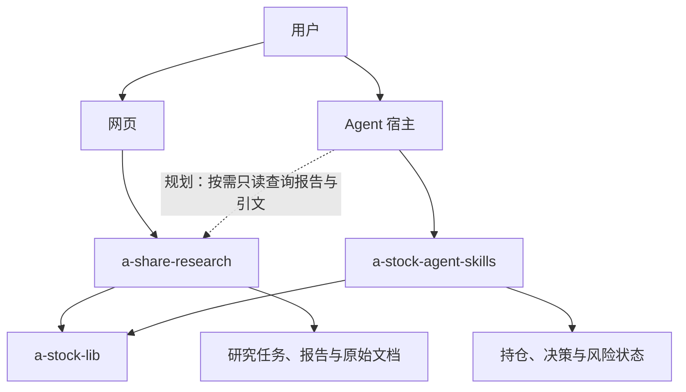

# A 股研究系统项目契约

更新：2026-10-22。覆盖 `a-share-research`、`a-stock-agent-skills`、`a-stock-lib`。

本文件是三个项目的职责与协作边界单一来源；[路线图](roadmap.md)定义演进条件，[实施计划](implementation-plan.md)定义工作包与验收。现行接口以各 owner 的代码和合同为准，标为“规划”的能力尚未实现。本文不改变投资规则，也不扩展各仓库 `AGENTS.md` 中的授权。

## 1. 共同目标与当前关系

服务一个用户的公司研究、研究复核和持仓风险检查。AI 提出假设、寻找反证、解释变化；程序负责数据口径、计算、状态与权限；用户确定目标、风险政策和具体账户动作。

实线是当前调用关系，虚线是候选接口。两个应用独立运行、存储和发布；Lib 是版本化 Python 包。当前没有 Research 与 Skills 之间的报告消费链路。

`a-stock-tracker` 已停止，保留为只读历史参考；旧 MCP 证据包计划已取消，不作为依赖、回退来源或待恢复任务。

## 2. 项目职责

| 项目 | 输入与交付 | 独占职责和状态 | 边界 |
|---|---|---|---|
| `a-share-research` | 公司代码/名称 → 有出处的财报报告、历史报告、价格参考 | 公告获取与原文定位、研究流程、引文与数字检查、模型复核、网页；研究 SQLite、PDF、任务和调用记录 | 只研究公司；持仓、投资决策合同和账户写入归 Skills runtime |
| `a-stock-agent-skills` | 用户研究目标/确认的账户事实 → 首次研究、持仓复核、风险与决策状态、文本 QA | 可移植 Skill、CLI runtime、框架路由、应用风险政策、持仓/交易/L3/Tier、`decision-v1`、`monitor-v1`、W1 写入控制 | Agent 循环由宿主承担；公共计算归 Lib；账户状态不交给财报应用 |
| `a-stock-lib` | 明确的数据请求或计算输入 → 结构化数据结果、评分与计算结果 | Provider、来源/时效/降级语义、A—F 类型与评分规则、估值和复权计算；必要的 Provider 缓存 | 不调模型，不编排研究，不拥有账户状态、网页或客户端安装逻辑 |

`a-share-research` 是应用名，`a-stock-research` 是 Skills 中的首次研究入口。前者判断“是否值得继续研究”，后者应用既有研究框架形成决策状态，不能直接映射两者的结论词。

财报应用的价格参考继续由应用拥有；Skills 的止损、仓位和风险政策继续由 runtime 拥有。公式可重复计算，不表示对应投资规则已证明有效。

## 3. 依赖与状态所有权

- 两个消费者均通过锁定版本及哈希的 Lib wheel 使用公共能力，不导入对方源码或跨项目读取数据库。
- 公共 Provider 保留来源、获取时间、数据时点、缺失与降级信息；消费者决定字段是否满足本次任务，不能把缺失默认为有效值。
- 财报应用优先使用现有 Lib Provider；缺少的接口按当前项目约束直接调用 TuShare。只有出现真实复用需求且语义一致时，才考虑把新增公共能力放入 Lib，不为统一目录搬迁应用代码。
- Lib 已被使用的 A—F 规则继续在原 owner 维护；框架路由、账户风险政策和应用动作出口仍在 Skills runtime。规则版本与软件版本分开，模型不能自行修改生效政策。
- 研究应用拥有研究库和 PDF；Skills 拥有账户库、风险政策及其运行状态。各自凭据由各自运行环境注入，不发现或借用另一项目的私有配置。
- 未来只读接口由研究应用提供。消费者通过该接口取得证据，不直连其 SQLite；接口故障不妨碍两个应用各自原有能力运行。
- 新研究由用户通过 Research 现有网页或 CLI 发起。当前未定义 Skills 向 Research 提交任务的接口；若需要跨项目自动提交，先明确任务所有权、触发授权和重复请求语义，更新本节与接口合同后再实施。

## 4. 接口所有权与质量含义

| 接口或产物 | Owner | 当前语义 |
|---|---|---|
| `MarketDataResult`、Provider、A—F 公共类型与计算 | Lib | 结构化数据、计算结果及质量元数据；不承担账户动作授权 |
| 财报报告 `body`、引文、程序财务表 | Research | 当前是应用内部结构，尚无对外发布的版本化报告合同 |
| `decision-v1` / `monitor-v1` | Skills runtime | 机器状态权威；Markdown 只作展示，不从自然语言反推状态 |
| QA 不可变正文快照与结果 | `a-stock-qa` | 仅支持 `a-stock-research` rubric；独立调用、文本检查，不联网核实事实 |
| 只读报告与引文接口 | Research，规划 | 先按真实消费需求定义最小合同；CLI/API/MCP 的传输选择不改变所有权 |

研究应用的机械检查验证引文字面存在和数字可匹配；模型复核检查主体、期间、方向、论断支持关系及重大遗漏。当前复核是独立请求，使用同一配置模型，不代表不同模型或独立数据源的交叉验证。

QA 通过只表示正文满足相应流程规则。报告核验、流程合规、账户动作可执行性和投资效果分别评价，不能相互代替；`a-stock-qa` 当前不用于财报应用或 Monitor。

### 规划中的最小证据合同

以下是 R2 阶段的语义要求，具体字段及版本在生产者与第一个消费者一起实现时定稿；当前不宣称已存在 `report-v1` 或 MCP 服务。

| 信息 | 必须能回答的问题 |
|---|---|
| 身份与版本 | 哪家公司、哪份报告、哪个生产者与合同版本？同一报告内的论断和引文如何稳定定位？ |
| 来源与时间 | 文档 URL、标题、报告期、公告时间、获取时间及已有内容哈希是什么？行情截至何时？ |
| 证据与口径 | 论断引用哪页原文或哪个结构化字段？其单位、期间和来源是什么？ |
| 检查与覆盖 | 哪些检查已经完成？材料覆盖哪些期间和来源？哪些论断、数据或结论仍有缺口？ |
| 运行身份 | 哪次任务、代码、模型、运行时和提示词产生该结果？未知身份必须显式保留未知 |

消费者须验证公司身份、支持的合同版本、任务需要的时效和覆盖范围。旧报告可以作为历史证据，但不能冒充最新快照；失败报告不得导出为已通过复核的结论。读取既有产物不自动触发重新研究、持仓变更或政策写入。

未来持续复核若需持久化，公开研究材料及其复核记录归 Research；涉及账户的分析、决策或监控状态归 Skills runtime，沿用具体用户确认和 `--confirm-write` 的 W1 门禁。纯展示的比较结果不要求新增持久状态。

来源材料作为数据处理，不赋予指令权限。首个接口只提供完成任务所需的研究内容，不暴露会话、凭据或完整模型调用日志。缺口、版本不支持和接口失败显式返回，Skill 只能按原有取证预算处理缺口，不静默补造结果。

## 5. 执行与授权

- Research 保持一个 Python 包、SQLite、PDF 目录、web/worker 两个进程，以及 pi 单次无工具模型调用。worker 重启后中断任务失败、由用户重跑，当前不承诺断点恢复。
- Skills 保持客户端中立；首次研究、持仓监控、QA 分开路由。只读查询与 W1 账户/分析状态写入分开，W1 延续具体用户确认和全局 `--confirm-write` 门禁。
- 报告结论、QA 结果或模型建议均不能代替账户事实、政策确认或动作授权；已成交事实的记录沿用现有记账规则。
- 自动交易不在本路线范围。定时研究、通知、新运行平台或 worker 内工具调用只有出现实际需求并按既有授权边界明确范围后才进入实现。
- 实施与验证状态见[实施计划](implementation-plan.md)。开发沿用已有授权；部署、数据库、cron、客户端安装、投资政策等操作分别服从所属仓库的现行约束，文档状态不授予额外权限。

## 6. 版本、验证与文档维护

生产者维护自己的合同；Lib 的公共合同变更覆盖两个真实消费者。包版本、合同版本、投资规则版本、模型/提示词身份和部署状态分别记录。运行记录用于归因和比较，不承诺模型逐字重现同一答案。

兼容性依据真实字段和枚举行为判断，不能只看版本号。沿用 Skills 已有的协调发布约束；新增只读报告接口要验证旧产物、未知版本、缺失证据和消费者行为。

同仓链接使用相对路径；跨仓链接指向各仓的正式分支。正文只在本目录维护，其他仓库保留职责摘要与入口。代码与文档冲突时先报告差异，以当前实现判断已具备能力；变更意图由本契约、路线图和明确需求说明。

| 维护内容 | 当前入口 |
|---|---|
| Research 产品与流程、运行与开发约束 | [重构方案](proposal.md)、[README](../README.md)、[AGENTS](../AGENTS.md) |
| Skills 状态合同、验证与实际部署 | [runtime contracts](https://github.com/on195594/a-stock-agent-skills/blob/master/docs/architecture/runtime-contracts.md)、[development](https://github.com/on195594/a-stock-agent-skills/blob/master/docs/development.md)、[operations](https://github.com/on195594/a-stock-agent-skills/blob/master/docs/operations.md) |
| Lib 公共数据语义与发版 | [Provider 合同](https://github.com/on195594/a-stock-lib/blob/master/docs/TUSHARE_PRIMARY_PROVIDERS.md)、[发版清单](https://github.com/on195594/a-stock-lib/blob/master/docs/RELEASE_CHECKLIST.md) |

普通维护更新现有 owner 文档；不复制三套契约、路线图或实施台账。私有账户资料、运行日志和原始评测产物留在仓库外；历史规格保留原日期含义。
