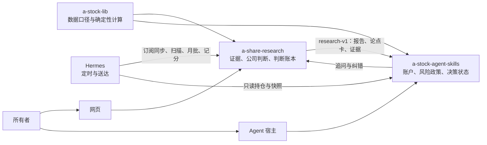

# A 股研究系统架构与项目契约

更新：2026-11-11。覆盖 `a-share-research`、`a-stock-agent-skills`、`a-stock-lib` 与调度方 Hermes。

本文件是三个项目的架构分层、职责与协作边界的单一来源；[路线图](roadmap.md)定义演进原则与阶段日期，[实施计划](implementation-plan.md)定义工作包与验收。现行接口以各 owner 的代码和合同为准，标为“方向”的内容尚未实现。本文不改变投资规则，也不扩展各仓库 `AGENTS.md` 中的授权。

## 1. 共同目标与当前关系

三个项目是一条价值链，不是三个并列产品：**证据 → 公司判断 → 账户决策 → 结果记分**，共同服务“所有者账户扣费后跑赢全收益基准”。AI 提出假设、寻找反证、解释变化；程序负责数据口径、计算、状态与权限；所有者确定目标、风险政策和具体账户动作。

箭头是当前调用关系。两个应用独立运行、存储和发布；Lib 是版本化 Python 包；Hermes 是宿主上的调度与消息服务，不属于这三个仓库。

各层随模型升级的走向不同，投入也不同：

| 层 | 内容 | Owner | 走向 |
|---|---|---|---|
| 事实与计算 | 披露原文、财务与行情、来源与时点、确定性公式 | Lib（两端共用口径）、Research 证据库与 `market.py`、Skills fetcher | 增值，长期投入 |
| 受控工具 | 取证、`calculate`/`valuation`、runtime CLI | Research 研究工具、Skills runtime | 增值，长期投入 |
| 判断与记分 | 报告、论点卡、预测、议程、候选批次、记分 | Research | 增值，系统的核心资产 |
| 账户与权限 | 持仓、交易、风险政策、W1 写入 | Skills runtime 与所有者 | 不交给 AI |
| Agent 脚手架 | 提示词、循环编排、运行上限、Skill 文本、路由 | 各自仓库 | 贬值，保持薄，模型升级时先删 |
| 调度与送达 | 定时任务、通知 | Hermes | 稳定，不承载业务规则 |

`a-stock-tracker` 已于 2026-10-24 归档（GitHub 只读、无服务、本地目录已删除，不可回滚），不作为依赖、回退来源或待恢复任务。

## 2. 项目职责

| 项目 | 输入与交付 | 独占状态 | AI 在哪里 | 边界 |
|---|---|---|---|---|
| `a-share-research` | 公司与研究问题 → 有出处的报告与回答、论点卡与立场、情景估值、检查点预测、价格参考；候选批次、研究观察表与模拟实验；判断记分 | 研究 SQLite、PDF、任务与调用记录、订阅代码 | worker 内的研究 AI 与独立复核；Python 持有循环、工具、核验与上限，模型只经 pi | 不保存持仓标签，不做账户动作、风险政策和通知投递 |
| `a-stock-agent-skills` | 用户目标与确认的账户事实 → 首次配置决策、持仓复核、风险与决策状态、文本 QA | 持仓与交易账本、L3/Tier、风险政策、`decision-v1`、`monitor-v1`、W1 写入控制 | 宿主 Agent 按 Skill 文本调用确定性 CLI；机器状态只来自 runtime | Agent 循环由宿主承担；公共计算归 Lib；账户状态不交给研究应用 |
| `a-stock-lib` | 数据请求或计算输入 → 带来源与时效的结构化结果、评分与计算结果 | 必要的 Provider 缓存 | 无 | 不调模型，不编排研究，不拥有账户状态、网页或客户端安装逻辑 |
| Hermes | 时间与事件 → 触发调用、送达消息 | 任务表与去重回执 | 定时任务是不跑模型的脚本；同时是 Monitor 的 Agent 宿主之一 | 不拥有判断、规则与业务状态；脚本源在 Research `ops/hermes/` |

**两个应用的判断分工**：Research 回答公司层面的“值不值、值多少、什么会证伪”，Skills 回答账户层面的“能不能买、买多少、何时必须处理”。Skills 的买入动作以 Research 有效论点卡立场为主干，A—F 矩阵作参考（Skills 现行规格）；Research 的结论与立场不等于账户动作，须与账户事实和风险政策合成后才成为 `decision-v1`/`monitor-v1`。`a-share-research` 是应用名，`a-stock-research` 是 Skills 中的首次研究入口。

**现存重复（方向）**：宿主 Agent 在 Skill 流程里自行取证、评分得出的公司结论，不经引文与计算核验，也不进判断账本；Research 的取证与核验工具目前只在 worker 内可用。方向是公司判断只由 Research 生产并记分，Skill 收敛为读卡、账户门禁与仓位，Research 的工具与核验对宿主 Agent 开放（[路线图第 3 节](roadmap.md#3-阶段与日期)）。落地须 Skills 的带日期规格与所有者授权，此前现行流程不变。

Research 的价格参考由应用拥有；Skills 的止损、仓位和风险政策由 runtime 拥有。模拟组合设计见[候选发现与研究实验方案](screening-experiment.md)。

## 3. 依赖与状态所有权

- 两个消费者通过锁定版本及哈希的 Lib wheel 使用公共能力，不导入对方源码或跨项目读取数据库。当前锁定见各自 `pyproject.toml`，发版记录见 Lib `CHANGELOG.md`；此前记在本节的锁定流水见 `git show d73505d:docs/project-contract.md`。
- **Lib 的实际共用面**：两端都用的是 TuShare Provider 基座、财务与估值历史、代码规范化。A—F 评分、周期与主观证据类型、送转、股息、行业与实时行情校验目前只有 Skills 使用，作为版本化规则留在 Lib。Research 另经 `market.py` 直连全市场截面、复权、停牌、卖方预测等接口。
- **入库判据**：同一指标同时出现在 Research 报告与 Skills 输出、口径必须一致时，下沉到 Lib 一处实现；只有一方使用的能力留在使用方。不为统一目录搬迁代码，也不为复用扩展 Lib。
- 公共 Provider 保留来源、获取时间、数据时点、缺失与降级信息；消费者决定字段是否满足本次任务，不能把缺失默认为有效值。
- A—F 规则在 Lib 维护；框架路由、账户风险政策和动作出口在 Skills runtime。规则版本与软件版本分开。AI 可以质疑 A—F 的适用性、提出替代假设；未经 owner 采用不能自行修改生效政策，不因框架不适用而禁止继续研究。
- Research 拥有研究库和 PDF（含候选批次、模拟实验与不带持仓标签的订阅代码）；Skills 拥有真实账户库、风险政策及其运行状态，交易与报告的关联存在 Skills 账本（写入前向 Research 核对报告 ID）。模拟与真实账户记录不混写。各自凭据由各自运行环境注入，不发现或借用另一项目的私有配置。
- 跨应用只经 Research 的 JSON API：网页与受委托的 Agent 共享研究任务、进度与证据，消费者不直连 SQLite。读取不触发研究，新建和纠错通过显式 POST。
- 任务及其成本、排队与记录归 Research。Agent 凭 owner 签发的具名、可撤销长期研究 API Key 代表所有者提交，短期令牌用于临时验收；服务端只存 Key 哈希，创建、列出与按编号撤销只经 owner 本地 CLI，API 仅能撤销自身凭据。请求编号相同且内容相同返回原任务，内容不同返回冲突；追问/纠错必须关联同公司报告。该授权不覆盖持仓、交易或政策写入。

## 4. 接口所有权与质量含义

| 接口或产物 | Owner | 消费者 | 当前语义 |
|---|---|---|---|
| `MarketDataResult`、Provider、代码规范化 | Lib | Research、Skills | 结构化数据及质量元数据；不承担账户动作授权 |
| A—F 公共类型、评分与规则哈希 | Lib | Skills | 确定性参考评分；评分不完整或被阻断时不用于动作 |
| `research-v1`：报告、证据、论点卡、追问/纠错、`GET /api/schema` | Research | Skills CLI、宿主 Agent | 路由与错误语义见 [README](../README.md#agent-研究-api)；body 由应用拥有，旧报告兼容读取；MCP 按宿主需要再加 |
| 订阅、披露扫描、月批与记分入口 | Research | Hermes 脚本 | Research 只存代码与订阅来源；调度与投递归 Hermes（[顾问闭环方案](investment-advisor.md#7-a4-窄范围主动复核research-扫描--hermes-调度)） |
| `decision-v1` / `monitor-v1` | Skills runtime | 宿主 Agent、Hermes | 机器状态权威；Markdown 只作展示，不从自然语言反推状态 |
| QA 不可变正文快照与结果 | `a-stock-qa` | 宿主 Agent | 仅支持 `a-stock-research` rubric；文本检查，不联网核实事实，不用于 Research 报告或 Monitor |

Research 的机械检查验证引文字面存在和数字可匹配；模型复核检查主体、期间、方向、论断支持关系及重大遗漏。复核是独立请求，可配置为不同于作者的模型（见[产品方案第 4 节](proposal.md#4-数据与模型)）；两个模型读同一份材料，不代表独立数据源的交叉验证。

报告核验、流程合规（QA）、账户动作可执行性和投资效果分别评价，不能相互代替。Skills `monitor-snapshot` 只读 `GET /api/cards`，把论点卡转成复核提醒：持仓与候选的划分、提醒门槛归 Skills，估值公式归 Research（[顾问闭环方案第 8 节](investment-advisor.md#8-a5-卖出复核接口skills-批次-b所有者-2026-11-01-已确认政策)）。

### 最小证据合同

`research-v1` 将公司、任务/报告 ID、状态、通过标记、覆盖范围及缺口与正文、证据分开返回。论断使用段落名和下标定位，引用携带 source/page/quote 或 ref/period；来源保留原文与程序计算输入。

新表格与计算行可带同单位的 `exact_values`，供程序使用未舍入值；既有 `values` 保留显示精度，旧产物缺少新字段时不补造原始精度。计算行名称由程序按运算类型生成，`calculation.requested_label` 仅记录模型提出的计算目的，不表示该财务指标定义已经核实。

| 信息 | 必须能回答的问题 |
|---|---|
| 身份与版本 | 哪家公司、哪份报告、哪个生产者与合同版本？同一报告内的论断和引文如何稳定定位？ |
| 来源与时间 | 文档 URL、标题、报告期、公告时间、获取时间及已有内容哈希是什么？行情截至何时？ |
| 证据与口径 | 论断引用哪页原文或哪个结构化字段？其单位、期间和来源是什么？ |
| 检查与覆盖 | 哪些检查已经完成？材料覆盖哪些期间和来源？哪些论断、数据或结论仍有缺口？ |
| 运行身份 | 哪次任务、代码、模型、运行时、提示词和判断契约产生该结果？未知身份必须显式保留未知 |

消费者须验证公司身份、支持的合同版本、任务需要的时效和覆盖范围。旧报告可以作为历史证据，但不能冒充最新快照；失败报告不得导出为已通过复核的结论。读取既有产物不自动触发重新研究、持仓变更或政策写入。

来源材料作为数据处理，不赋予指令权限。接口只提供完成任务所需的研究内容，不暴露会话、凭据或完整模型调用日志。缺口、版本不支持和接口失败显式返回，Skill 只能按原有取证预算处理缺口，不静默补造结果。

持续复核需要持久化时，公开研究材料及其复核记录归 Research；涉及账户的分析、决策或监控状态归 Skills runtime，沿用具体用户确认和 `--confirm-write` 的 W1 门禁。

## 5. 执行与授权

- Research 保持一个 Python 包、SQLite、PDF 目录、web/worker 两个进程和 pi；研究工具清单与上限见 `research_tools.py`、`limits.py`。重启后中断任务失败、由用户重跑，不承诺断点恢复。
- Skills 保持客户端中立；首次研究、持仓监控、QA 分开路由。只读查询与 W1 写入分开，W1 需要具体用户确认和全局 `--confirm-write`。
- 报告结论、QA 结果或模型建议均不能代替账户事实、政策确认或动作授权；已成交事实的记录沿用现有记账规则。
- Hermes 只决定何时触发和送达给谁：从 Skills 只读同步持仓代码为 Research 订阅，触发披露扫描、月批与记分，推送结果。开启或新增通知须所有者当次授权。
- 自动交易不在范围。开发沿用已有授权；部署、数据库、cron、客户端安装、投资政策等操作分别服从所属仓库的现行约束，文档状态不授予额外权限。

## 6. 版本、验证与文档维护

生产者维护自己的合同；Lib 的公共合同变更覆盖两个真实消费者，Research 的接口变更覆盖 Skills 与 `ops/hermes/`。包版本、合同版本、判断契约版本、投资规则版本、模型/提示词身份和部署状态分别记录。运行记录用于归因和比较，不承诺模型逐字重现同一答案。

兼容性依据真实字段和枚举行为判断，不能只看版本号。沿用 Skills 已有的协调发布约束；研究 API 要验证旧产物、未知版本、缺失证据和消费者行为；GET 使用 SELECT，不做取数或补写。

同仓链接使用相对路径；跨仓链接指向各仓的正式分支。正文只在本目录维护，其他仓库保留职责摘要与入口。代码与文档冲突时先报告差异，以当前实现判断已具备能力；变更意图由本契约、路线图和明确需求说明。

| 维护内容 | 当前入口 |
|---|---|
| Research 产品与流程、运行与开发约束 | [产品方案](proposal.md)、[README](../README.md)、[AGENTS](../AGENTS.md) |
| Research 当前部署、回退与后续实施 | [部署记录](implementation-plan.md#当前部署)、[工作包与状态](implementation-plan.md#工作包与状态) |
| Skills 状态合同、验证与实际部署 | [runtime contracts](https://github.com/on195594/a-stock-agent-skills/blob/master/docs/architecture/runtime-contracts.md)、[development](https://github.com/on195594/a-stock-agent-skills/blob/master/docs/development.md)、[operations](https://github.com/on195594/a-stock-agent-skills/blob/master/docs/operations.md) |
| Lib 公共数据语义与发版 | [Provider 合同](https://github.com/on195594/a-stock-lib/blob/master/docs/TUSHARE_PRIMARY_PROVIDERS.md)、[发版清单](https://github.com/on195594/a-stock-lib/blob/master/docs/RELEASE_CHECKLIST.md) |
| Hermes 定时脚本与安装 | [ops/hermes](../ops/hermes/README.md)、[上线后接入](implementation-plan.md#当前部署) |

普通维护更新现有 owner 文档；不复制三套契约、路线图或实施台账。私有账户资料、运行日志和原始评测产物留在仓库外；历史规格保留原日期含义。
